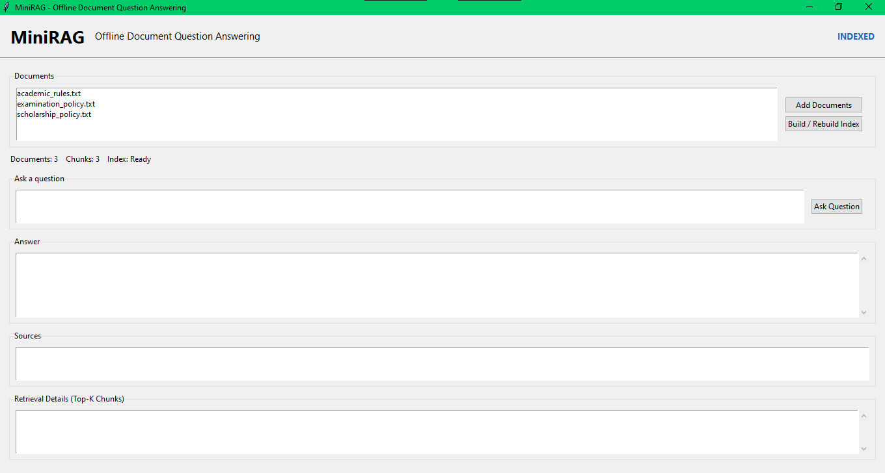
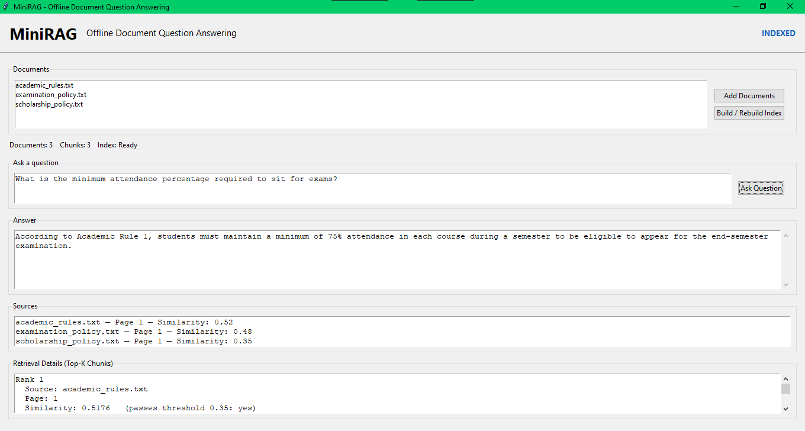
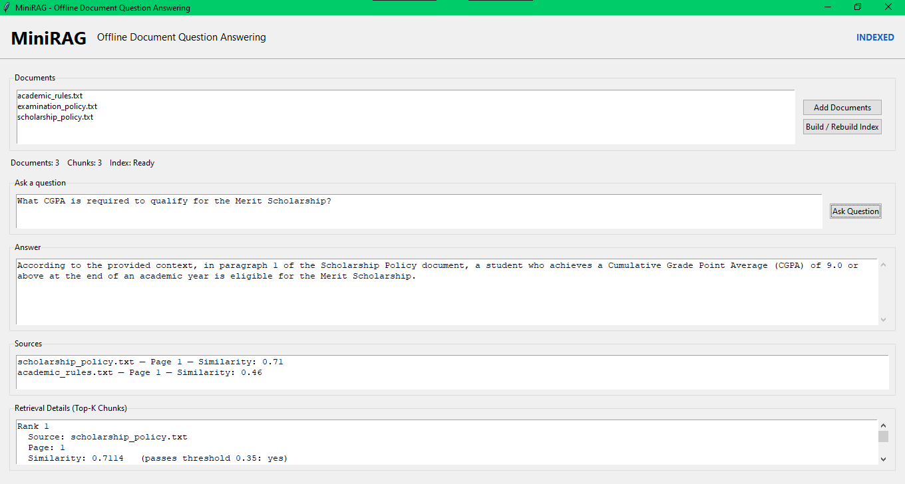
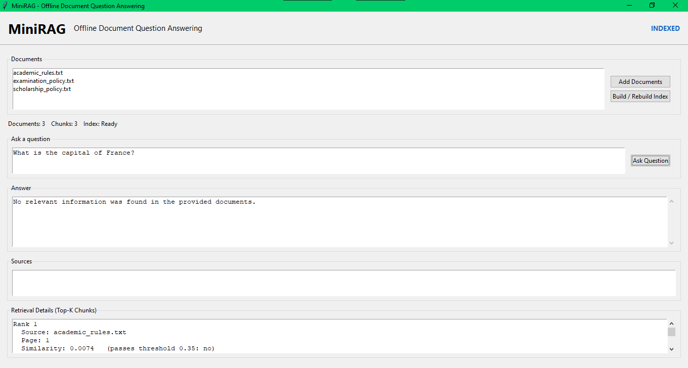
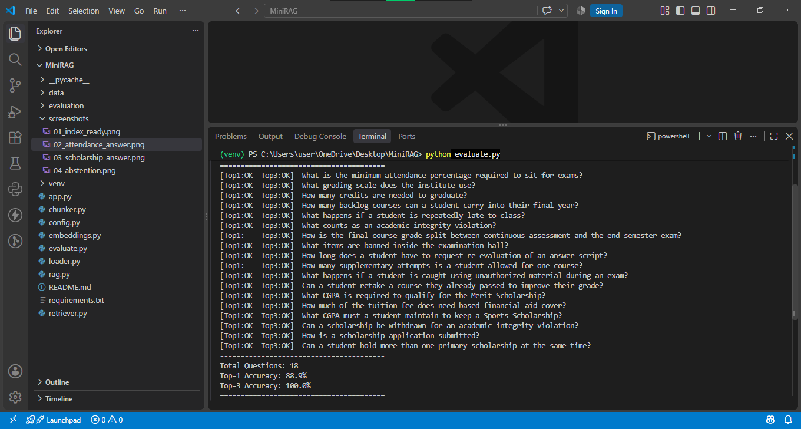

# MiniRAG — Offline Evidence-Grounded Document Question Answering System

A small, self-contained Retrieval-Augmented Generation (RAG) desktop
application built for a college minor project. It answers questions
**only** using evidence retrieved from documents you provide, cites the
exact source document and page number for every answer, and refuses to
answer when it cannot find relevant evidence — entirely offline, using
a locally-running LLM through Ollama.

---

## 1. Description

MiniRAG lets you drop in your own PDF/TXT documents, builds a local
semantic search index over them, and then answers natural-language
questions strictly grounded in that index. It is intentionally small
(~800 lines of Python across 8 files) so every stage of the RAG
pipeline is easy to read, run, and explain in a viva.

## 2. Features

- Add PDF and TXT documents through a simple desktop GUI
- Automatic text extraction (page-aware for PDFs) and word-based chunking
- Local sentence-embedding generation (`all-MiniLM-L6-v2`)
- Exact cosine-similarity search using a FAISS index (persisted to disk)
- Top-K retrieval with a configurable similarity threshold
- **Abstention**: if no chunk is relevant enough, MiniRAG says so instead
  of guessing, and never calls the LLM in that case
- Answers generated by a local Ollama model, grounded only in retrieved text
- Every answer is shown with its source document, page number, and
  similarity score
- A retrieval-details panel showing the raw Top-K chunks (for demos/vivas)
- Standalone retrieval evaluation script with Top-1 / Top-3 accuracy

## 3. Architecture

```
DOCUMENTS (PDF / TXT)
        │
        ▼
   TEXT EXTRACTION        (loader.py)
        │
        ▼
   CHUNKING                (chunker.py)
        │
        ▼
   EMBEDDINGS               (embeddings.py — sentence-transformers)
        │
        ▼
   FAISS VECTOR INDEX       (retriever.py)
        │
        ▼
   SEMANTIC RETRIEVAL       (retriever.py — top-K cosine search)
        │
        ▼
   TOP-K RELEVANT CHUNKS
        │
        ▼
   LOCAL LLM                (rag.py — Ollama)
        │
        ▼
   GROUNDED ANSWER + SOURCE CITATIONS
```

`app.py` is the Tkinter GUI and orchestrates all of the above; it
contains no RAG logic itself, only wiring and display.

## 4. Technologies

- Python 3.13 (tested)
- Tkinter / ttk (GUI)
- PyMuPDF (`fitz`) — PDF text extraction
- sentence-transformers (`all-MiniLM-L6-v2`) — embeddings
- FAISS (`faiss-cpu`) — vector similarity search
- Ollama — local LLM inference

No web framework, no LangChain/LlamaIndex, no cloud APIs are used
anywhere in this project.

## 5. Screenshots

### Index Ready



### Grounded Answer — Attendance



### Grounded Answer — Scholarship



### Abstention on Unrelated Question



### Retrieval Evaluation




## 6. Folder Structure

```
MiniRAG/
│
├── app.py                    Tkinter GUI + orchestration
├── config.py                 All tunable settings
├── loader.py                 PDF/TXT text extraction
├── chunker.py                Word-based chunking with overlap
├── embeddings.py             sentence-transformers wrapper
├── retriever.py               FAISS index build/save/load/search
├── rag.py                    Prompt building + Ollama call + abstention
├── evaluate.py                Standalone retrieval evaluation script
├── requirements.txt
├── README.md
│
├── evaluation/
│   └── questions.json         Labeled evaluation questions
│
└── data/
    ├── documents/              Sample + user-added PDF/TXT files
    └── index/                  Saved FAISS index + metadata.json
```

## 7. Installation (Windows)

```
python -m venv venv
venv\Scripts\activate
pip install -r requirements.txt
```

The first run will download the `all-MiniLM-L6-v2` embedding model
(a few hundred MB) from Hugging Face; after that it is cached locally.

## 8. Ollama Setup

1. Download and install Ollama from https://ollama.com
2. Confirm it's running (it starts a local server at
   `http://localhost:11434`).
3. Pull the model configured in `config.py` (default `llama3.2:3b`):

   ```
   ollama pull llama3.2:3b
   ```

4. To use a different model, edit `OLLAMA_MODEL` in `config.py` and
   pull that model instead.

## 9. How to Run

```
python app.py
```

This opens the MiniRAG window.

## 10. How to Add Documents

Click **Add Documents** and select one or more PDF/TXT files. They are
copied into `data/documents/`. Three fictional sample TXT documents
(`academic_rules.txt`, `examination_policy.txt`, `scholarship_policy.txt`)
are already included so you can try the app immediately without
sourcing your own files. These are clearly labeled as sample/demo data
and are not real policies of any institution.

## 11. How to Build the Index

Click **Build / Rebuild Index**. This extracts text from every
document in `data/documents/`, chunks it, embeds every chunk, and
builds/saves a FAISS index to `data/index/`. Re-click this button any
time you add or remove documents — it always rebuilds from scratch, so
the index is a straightforward reflection of what's currently in
`data/documents/`.

## 12. How to Ask Questions

Type a question in the **Ask a question** box and click **Ask
Question**. MiniRAG will:

1. Embed your question
2. Retrieve the Top-K most similar chunks from the FAISS index
3. Check whether any chunk clears `SIMILARITY_THRESHOLD`
4. If yes → send those chunks + your question to Ollama and display the
   grounded answer, its sources, and similarity scores
5. If no → display "No relevant information was found in the provided
   documents." without calling the LLM at all

The **Retrieval Details** panel always shows the raw Top-K chunks,
their source/page/similarity, and a text preview — useful for
demonstrating the retrieval step separately from generation.

## 13. How Evaluation Works

`evaluate.py` measures **retrieval** accuracy, not generation quality.
It loads `evaluation/questions.json` (18 labeled questions, each with
an expected source document and page), runs retrieval for each
question, and checks whether the expected (source, page) appears in
the Top-1 result and in the Top-3 results. Run it after building the
index:

```
python evaluate.py
```

Example output:

```
========================================
MiniRAG Retrieval Evaluation
========================================
[Top1:OK  Top3:OK]  What is the minimum attendance percentage required to sit for exams?
...
----------------------------------------
Total Questions: 18
Top-1 Accuracy: 88.9%
Top-3 Accuracy: 100.0%
========================================
```

(Actual numbers depend on your index and embedding model — this
script always computes them fresh, it never hardcodes results.)

## 14. Example Workflow

1. Run `python app.py`
2. The three sample documents are already present — click **Build /
   Rebuild Index**
3. Observe `Documents: 3   Chunks: 3   Index: Ready`
4. Ask: *"What is the attendance requirement?"*
5. See the grounded answer, its source (`academic_rules.txt — Page 1`),
   and similarity score, plus the retrieved chunks below
6. Ask something unrelated, e.g. *"What is the capital of France?"*
7. See: *"No relevant information was found in the provided documents."*

## 15. Limitations

- Retrieval quality depends entirely on chunk size/overlap and the
  small embedding model used; it is not tuned for large document
  collections.
- The similarity threshold is a simple heuristic, not a guarantee of
  factual correctness — a passing similarity score means a chunk is
  topically relevant, not that the LLM's answer is necessarily correct.
- TXT files are treated as a single logical page (page = 1); only PDFs
  get real page-level citations.
- No OCR — scanned/image-only PDFs will fail to extract text.
- Single-user, local-only; there is no authentication, history, or
  multi-user support by design.

## 16. Future Scope

- Add DOCX support
- Smarter (semantic/paragraph-aware) chunking
- Support multiple simultaneous Ollama models for comparison
- Basic OCR fallback for scanned PDFs
- Export retrieval/evaluation reports to a file
